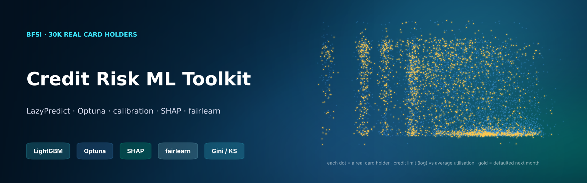
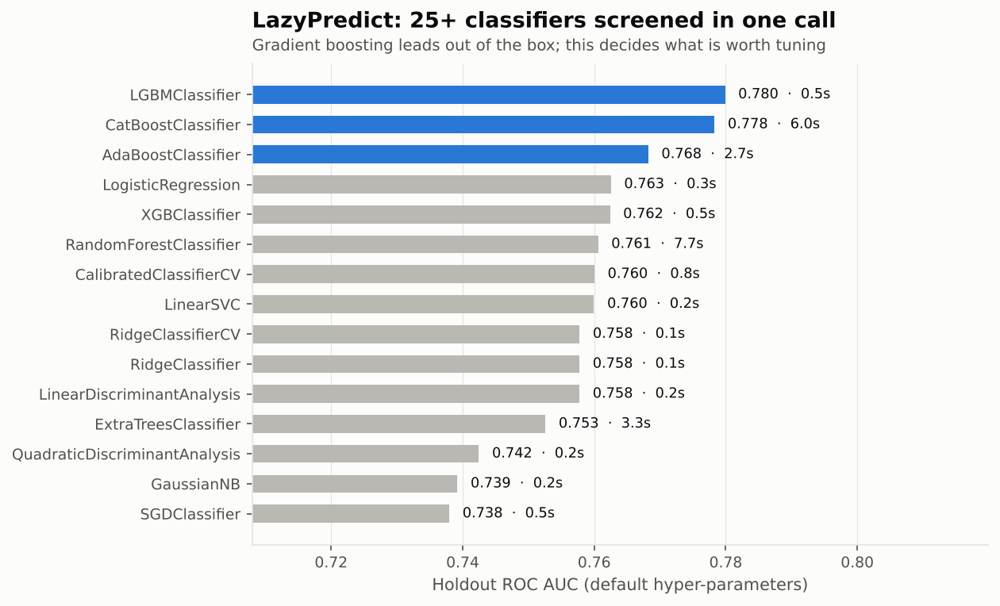
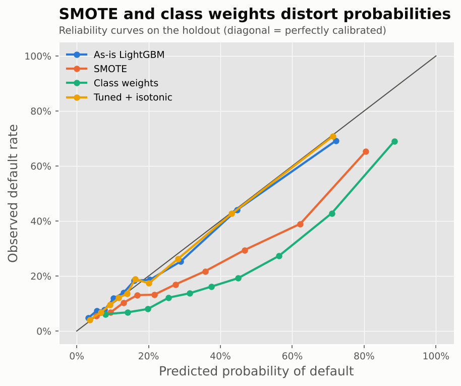
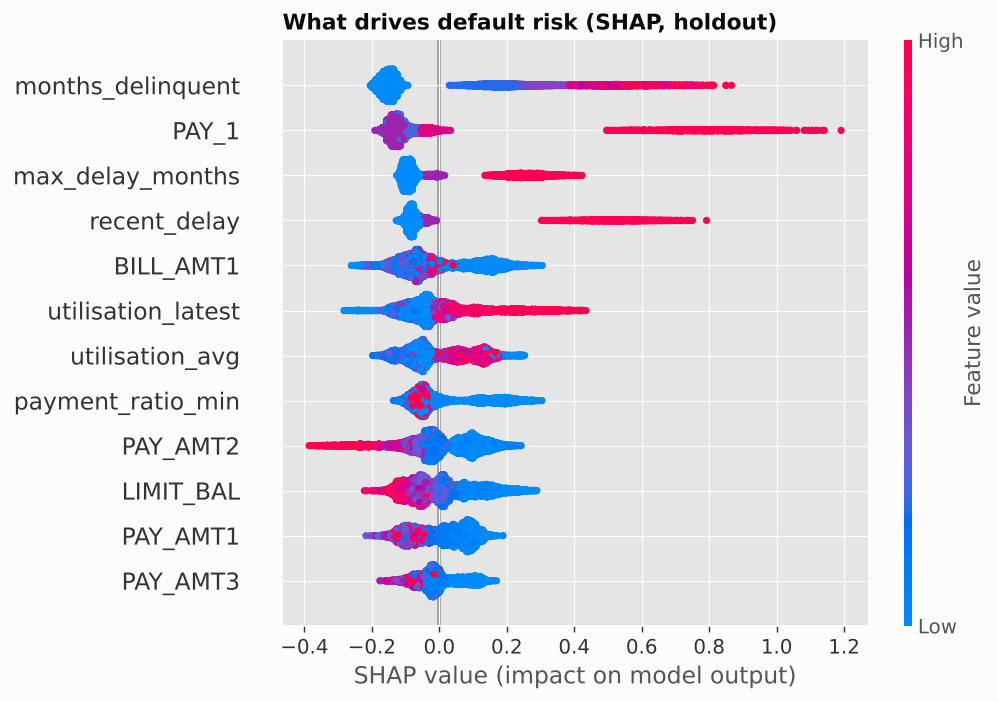
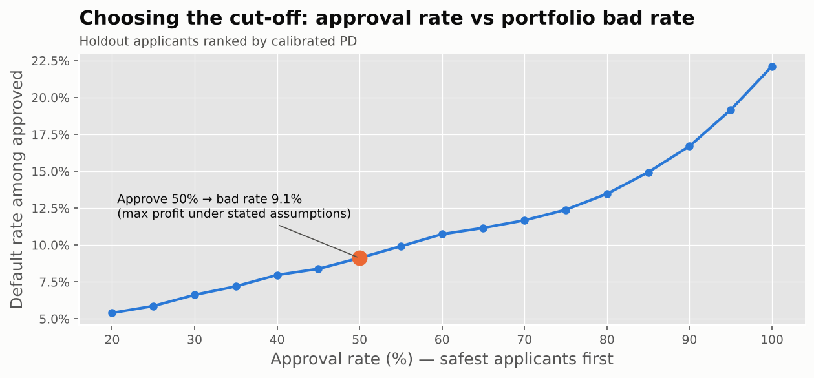
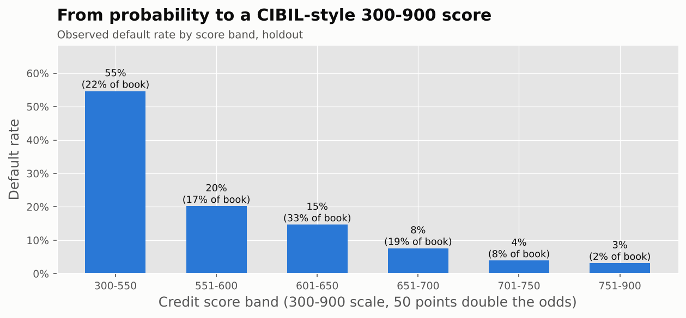
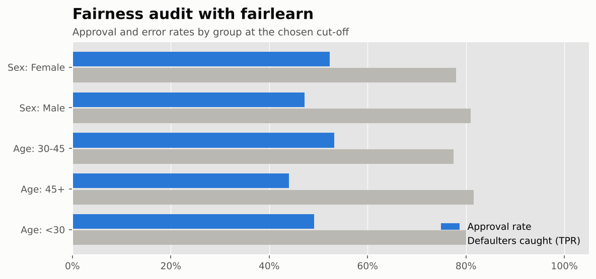

<p align="center"></p>

<p align="center">
  
  
  
  
  
</p>

# Credit Default Risk: the Modern Toolkit Around Classical ML

Classical gradient boosting still wins on tabular data. What has changed is the **tooling around it**. This project runs a complete credit-risk
workflow on **30,000 real credit-card customers**, using the libraries that make classical ML faster, more honest and easier to defend:

| Step | Tool | Question it answers |
|---|---|---|
| Screen | **LazyPredict** | Which of 27 model families are worth tuning? |
| Imbalance | **imbalanced-learn** | Does SMOTE or class weighting actually help? |
| Tune | **Optuna** (TPE sampler + median pruning) | What are the best hyper-parameters, without wasting compute on bad trials? |
| Calibrate | scikit-learn `CalibratedClassifierCV` | Can the probabilities be used for pricing and provisioning? |
| Explain | **SHAP** | Why was *this* applicant declined (reason codes)? |
| Audit | **fairlearn** | Are approval and error rates comparable across sex and age groups? |
| Monitor | PSI (implemented) | Will the score drift, and what would a stress scenario do? |
| Business | Gini, KS, gains table, cut-off strategy, **CIBIL-style 300–900 score** | How does this become a lending policy? |

Everything is in one executed notebook: [`notebooks/credit_risk_toolkit.ipynb`](notebooks/credit_risk_toolkit.ipynb)

> **Data:** *Default of Credit Card Clients* (UCI; Yeh & Lien, 2009). 30,000 real card holders, 23 raw attributes, target = default next month (22.1%).
> CC0, loaded from the Hugging Face Hub (`scikit-learn/credit-card-clients`). The undocumented EDUCATION/MARRIAGE codes are cleaned, and 11 behavioural features are engineered
> (delinquency counts, worst delay, utilisation level and trend, share of bill paid, months with no payment, months over limit).

---

## Results

| | Result |
|---|---|
| 🔎 **LazyPredict** | 27 classifiers in under 4 minutes. **LightGBM (AUC 0.780) and CatBoost (0.778)** lead, and logistic regression (0.763) is a strong interpretable baseline. That decides what is worth tuning. |
| ⚖️ **Imbalance** | SMOTE and class weights **don't improve ranking** (CV AUC 0.758 / 0.780 vs 0.781 as-is), but they **inflate predicted default probabilities from 22% to 32–40%** against an actual 22%. In lending, probabilities feed pricing and provisions, so **no resampling**: a decision threshold does the job. |
| 🎯 **Optuna** | 20 trials of 3-fold CV, **13 pruned early** by the median pruner. Best CV AUC 0.788. The tuned LightGBM reaches **holdout AUC 0.783, Gini 0.565, KS 0.43**, ahead of XGBoost and CatBoost defaults and +0.02 AUC over logistic regression. |
| 📏 **Calibration** | LightGBM is already well calibrated (Brier 0.134). Isotonic calibration keeps it there; the SMOTE and class-weighted models are visibly off the diagonal. |
| 📊 **Gains** | The riskiest 10% of customers hold **32% of all defaulters** (bad rate 71%, lift 3.2x). The riskiest 20% hold 51%. |
| 💰 **Cut-off** | Assuming a 12% annual margin on good accounts and 60% loss-given-default (stated in the code), profit peaks at **approving the safest 50%**, whose bad rate is **9.1%** against 22.1% for the whole book. The profit curve is **flat between 45% and 70% approval**, so the business can trade a little profit for growth. Above 90% approval the portfolio loses money. |
| 🔢 **Score** | PDs mapped to a **300–900 scale** (650 at 9:1 odds; 50 points double the odds). Default rate falls from **55% in the 300–550 band to 3% in 751–900**. |
| 🧾 **SHAP** | Top drivers: **months with a late payment**, last month's payment delay, worst delay in 6 months, then the latest bill and credit utilisation. Larger recent payments and higher limits pull risk down. Every declined applicant gets **plain-English principal reasons** (e.g. *"Payment delay last month; Months with a late payment; Credit limit"*). |
| 🧑‍⚖️ **Fairness** | At the 50% cut-off, approval-rate ratios are **0.90 by sex and 0.83 by age**, both inside the four-fifths (0.8) rule of thumb. Customers **aged 45+ are still the least-approved group** (44% vs 53% for 30–45s) while their true-positive rate is the highest, so this is worth monitoring as the cut-off moves. At a stricter 40% cut-off the age ratio falls below 0.8. Sex and age are not removed from the data here; they are used only to *audit* outcomes. |
| 📈 **Stability** | PSI between training and holdout scores is **0.001** (stable). Under a stress scenario (credit limits cut 30%, and 15% of customers slipping two months behind, applied to the raw data and then re-engineered), **PSI jumps to 0.127, the 'investigate' zone**, and mean PD rises from 22.4% to 29.2%. That is the alert a monitoring job should raise. |

<p align="center">
  
  
</p>
<p align="center">
  
  
</p>
<p align="center">
  
  
</p>

---

## Run it

```bash
pip install -r requirements.txt
cd notebooks && jupyter nbconvert --to notebook --execute --inplace credit_risk_toolkit.ipynb   # ~30 min on a 4-core CPU
pytest -q     # feature engineering, Gini/KS, score scaling, PSI, gains/cut-off, reason codes
```

## Structure

```
├── notebooks/credit_risk_toolkit.ipynb   the full workflow, executed
├── src/
│   ├── credit.py      cleaning, features, Gini/KS, gains, cut-off, 300-900 scaling, PSI, SHAP reason codes (tested)
│   └── charts.py
├── reports/           LazyPredict leaderboard, holdout results, gains table, model card
├── images/ · assets/
└── tests/
```

---

**Author:** Husein Ghadiali · Data Analyst · MS Business Analytics · [LinkedIn](https://linkedin.com/in/husein-ghadiali)
